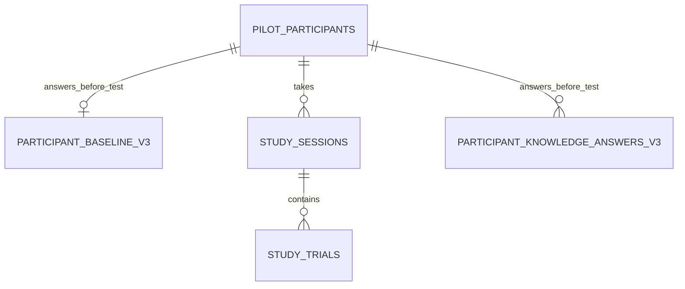

# Pilot data model

Pilot and classroom projects use the same current questionnaire and table shape. The pilot keeps earlier survey versions untouched. Twelve analysis cells are derived from `assigned_group` (A–D) × `music_experience_band` (1–3); they are not twelve separate tables.

## Baseline before the listening test

`participant_baseline_v3` stores one pre-test survey per participant:

- `music_experience_duration`: raw response (`none`, `under_1`, `1_to_3`, `3_to_6`, `6_plus`).
- `music_experience_band`: derived three-level analysis band: 1 = 3+ years, 2 = 1–under 3 years, 3 = none or under 1 year. The codes are categories, not equal numeric quantities.
- `primary_instrument_family`: the participant's longest-experienced instrument family.
- `instrument_pitch_control`: derived profile: stepwise, continuous, unpitched, none, or other.
- Historical pilot records may contain `wind_band_member` (the original wind-band-only question). The revised survey records `music_club_experience` (any music-related club, such as wind band, choir, or light music club); these are separate fields and should not be treated as equivalent. `music_club_experience_captured_at` identifies when the revised answer was recorded.
- Other pitch-app use, absolute-pitch self-report, and relative-pitch self-rating (1–5).
- `survey_version` and `captured_at`.

Piano/keyboard, woodwinds such as flute, valved brass, fretted strings, and pitched percussion are classified as `stepwise`; slide brass such as trombone and bowed strings as `continuous`; drum-type percussion as `unpitched`. The detailed family and the pitch-control profile are both retained so a later analysis can compare instruments within a profile. Sparse instrument families are exploratory; do not combine or interpret small cells as confirmatory evidence.

## Knowledge questions before the listening test

The three interval-knowledge answers (including `dont_know`) are completed before listening. `participant_knowledge_answers_v3` stores one answer per participant and item. The pre-test then follows the same questionnaire on every device. Since interval terms are shown before listening, this can prime some participants to think in named intervals; interpret scores as performance after that prompt, and keep the order fixed for everyone.

## Session and trial data

A `study_sessions` row represents one 10-question set, identified by participant, mode, session number, and assessment wave. `study_trials` remains the detailed source data: reference and target MIDI, answer, accuracy, error, time, target/reference crossings, snap count, replay count, and slider trajectory. Summaries and graphs should be computed from these rows.

Earlier `participant_baseline` and `baseline_knowledge_answers` rows remain historical v1/v2 data. v4 answers go to versioned tables and do not overwrite them. Use `supabase/queries/pilot_baseline_v3_export.sql` and `supabase/queries/pilot_export.sql` for de-identified exports; never export participant codes or the private roster crosswalk.

A 10-person A/D pilot can confirm the procedure and data flow, not establish group-specific treatment effects. Keep the class-to-participant crosswalk outside Supabase and restrict access to it.
