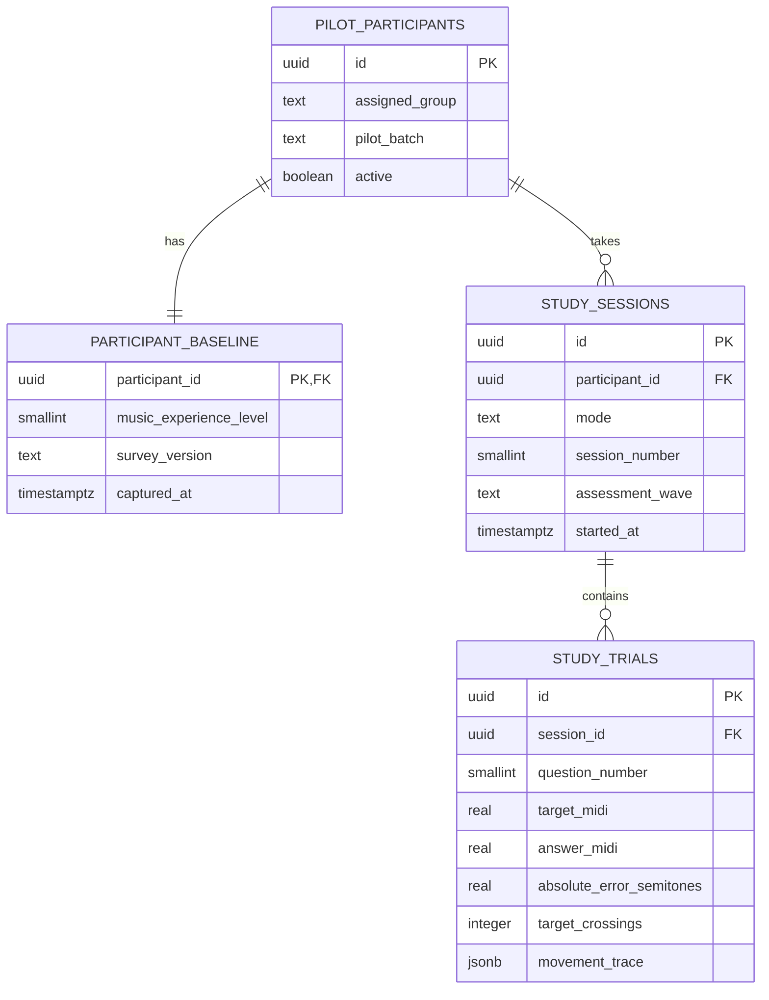

# Pilot data model

This pilot keeps the database in a relational shape. The 12 analysis groups are derived from `assigned_group` (A–D) × `music_experience_level` (1–3); they are not 12 separate tables. This keeps every trial in one consistent format and makes later comparisons reproducible.

## Definitions

- Experience level is a self-reported category captured once for each participant: `1` = experienced, `2` = some experience, `3` = no experience. It is categorical; do not treat the numbers as equal-interval measurements.
- A session is one 10-question set. `session_number` increments separately within each mode, so a participant can have `pretest_1`, `pretest_2`, `training_1`, `training_2`, and `posttest_1`.
- `study_trials` remains the fine-grained source data, one row per question. Summary graphs should be calculated from these rows, rather than entered by hand.
- The 12 cells are useful for organizing and describing data. A 10-person pilot will leave many cells empty or very small, so those cells should not be used to claim group-specific effects. Use the pilot to check the procedure, measurement quality, and data flow.
- Attendance numbers such as `3_15` stay in the private crosswalk CSV on the researcher’s device. The database contains a random UUID, not a class/attendance number or name. Keep that crosswalk access restricted and separate from exported trial data.
- Use a separate Supabase project and a new `pilot_batch` for any later classroom study. Do not pool pilot and classroom records without an explicit analysis plan.

The query `analysis/experience_group_counts.sql` creates all 12 group-by-experience rows, including empty cells. `analysis/practice_trends.sql` reports training-set trends by group, experience level, and practice set. `supabase/queries/pilot_export.sql` exports trial-level data together with participant attributes and session order.
